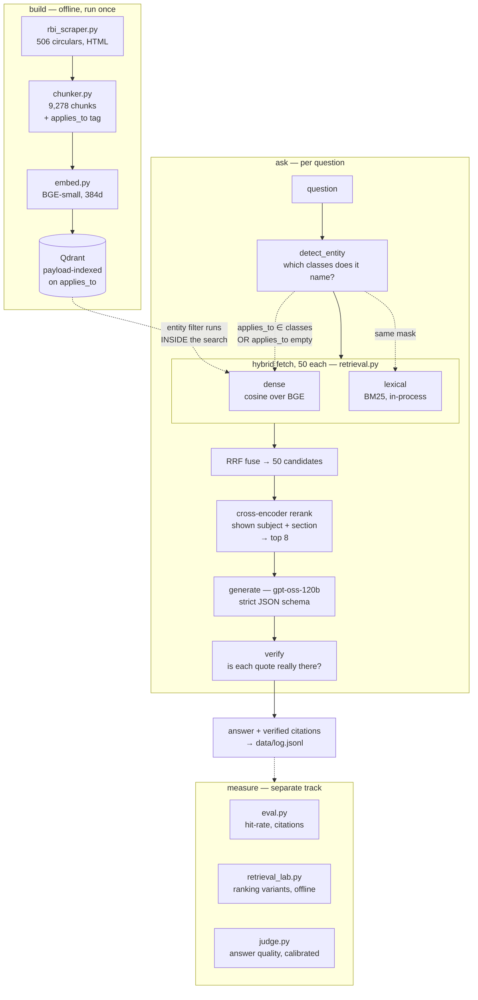

# RegRAG

A question-answering system over 506 RBI (Reserve Bank of India) circulars. Ask a
question about Indian banking regulation; get an answer with citations that are
automatically verified against the source documents.

**Status: end-to-end pipeline working and measured against a hand-written answer
key, with each failure attributed to retrieval or to generation.** That attribution
identified retrieval as the bottleneck, and the current work is closing it: chunk
recall is **78%, up from 60%**, via a lexical channel and a cross-encoder over the
same embeddings. The end-to-end answer score of 65% was measured *before* that
change and has not yet been re-run — see the note in **Generation** below. Every
number here is reproducible from `data/eval/`.

## Why this corpus is harder than it looks

RBI reissues the same rule once per class of regulated entity — a KYC amendment
exists as ten near-identical circulars, one each for Commercial Banks, Small
Finance Banks, NBFCs, and so on. **74% of the corpus sits in a near-duplicate
family.** Retrieval that ignores which entity a document binds returns the wrong
institution's rules most of the time (measured: 35% precision unfiltered vs. 92%
with the entity filter — see `embed.py entity-test`). Every chunk in this pipeline
carries an `applies_to` tag for exactly this reason.

This one property shapes every design decision below, and it is also why several
obvious-looking metrics turn out to measure less than they appear to.

## Architecture



The one structural decision worth reading off this diagram: **the entity filter
runs inside the vector search, not after it.** Filtering a top-k after the fact
would mean discarding most of what came back and padding with whatever was left,
because ~74% of this corpus is near-duplicates and an unfiltered top-8 fills with
other institutions' copies of the same rule. That is why `applies_to` lives on
every chunk rather than in a table you join against.

## Pipeline

Each stage is a standalone script, run in order:

```
python rbi_scraper.py harvest     # walk RBI's circular pages -> manifest.db
python rbi_scraper.py text        # cache each circular's full body -> data/html/
python chunker.py                 # split into retrieval-sized chunks -> chunks.jsonl
python embed.py build             # embed every chunk (BGE-small)   -> embeddings.npy
python index_qdrant.py build      # load into Qdrant (needs Docker) -> local vector index
python retrieval.py ask "..."     # retrieval only: hybrid fetch + rerank, no LLM
python rag.py ask "..."           # ask a question
python rag.py history             # everything ever asked, all-time
```

Evaluation is a separate track, deliberately split by what each metric costs:

```
python qa.py draft                # add question stubs to data/qa_draft.yaml
python qa.py validate             # what's incomplete or malformed
python qa.py export               # -> data/qa.jsonl, the graded set
python eval.py retrieval          # hit-rate@k -- local, free, unlimited
python eval.py retrieval --sweep  # recall vs k
python retrieval_lab.py baseline  # check the offline bench matches the pipeline
python retrieval_lab.py run <v>   # score a retrieval variant, resumable
python retrieval_lab.py compare   # every variant scored so far, side by side
python retrieval_lab.py inspect q017   # one question, every variant, in full
python eval.py answers            # end-to-end run (costs quota, resumable)
python eval.py answers --oracle   # feed gold chunks, bypass retrieval
python eval.py report             # scorecard from whatever has been run
python judge.py calibrate         # validate the judge BEFORE trusting it
python judge.py run [--oracle]    # grade answer quality against the key
python judge.py report            # verdict breakdown
```

### Requirements to run generation

- **Qdrant** running locally: `docker run -d --name qdrant -p 6333:6333 -v qdrant_storage:/qdrant/storage qdrant/qdrant`
- **A Groq API key** (free tier) — get one at <https://console.groq.com>, then
  `cp .env.example .env` and paste it in.

  Generation needs strict JSON-schema output, so the model must be one that
  supports it (`openai/gpt-oss-120b` or `-20b`). On the free tier the binding
  limit is **tokens per day (200,000)**, not requests per day (1,000): at ~2,900
  tokens per call that is roughly 70 questions a day, and 8,000 tokens/minute
  caps throughput at ~3 calls a minute. `rag.py` paces itself against the
  per-minute ceiling rather than absorbing 429s. Limits are per model, so a
  second model can carry the eval judge on its own allowance.

  One non-obvious failure mode, since it cost two questions in the first full
  run: under strict JSON schema an answer that exceeds the output budget is not
  a *shorter* answer, it is **no answer** — the object never closes, the required
  fields after it are never emitted, and the API rejects the whole reply with a
  400. `gpt-oss` also spends reasoning tokens from that same budget, so a cap set
  near the expected answer length starves the answer entirely and returns an
  empty generation. `GROQ_MAX_OUTPUT_TOKENS` defaults to 4096 for this reason;
  the longest legitimate answer in the ground-truth set needed 2,311.

## The corpus

- **506 circulars**, Feb 2024 – Aug 2026, harvested directly (PDF downloads are
  blocked by a WAF; the corpus is built from the same detail pages' HTML instead —
  see the design note at the top of `rbi_scraper.py`)
- **9,278 chunks**, each carrying its document's number, date, department, and the
  regulated-entity classes it binds

## The answer key

**90 questions written by hand, before any pipeline output was looked at.** That
ordering is the whole point: grade after seeing results and you unconsciously
write a key the system passes.

| Category | n | What it stresses |
|---|---|---|
| `lookup` | 31 | Single fact, single document |
| `entity_scoped` | 25 | Right rule, right institution — the near-duplicate problem |
| `amendment` | 15 | Documents stating deltas, not rules |
| `cross_document` | 10 | Needs evidence from two circulars at once |
| `unanswerable` | 9 | Correct behaviour is to refuse |

69 are answerable, 21 are not. Note that only 9 sit in the `unanswerable`
*category*: the other 12 were written as ordinary questions and turned out to have
no answer in the corpus, discovered only when going to the source to write the
answer down. That makes them refusal tests in disguise — they look perfectly
answerable, and a system that always produces something confident fails them while
passing everything else.

The key has been revised twice since the answer runs below were scored, so their
denominators reflect the export in force at the time. Each run's rows store their
own `answerable` flag rather than re-deriving it, so old results stay
interpretable instead of silently re-scoring themselves.

`gold_chunk_ids` records which chunks a question was drafted against. That is
usually also where it is answered, but not always: a question drafted from a
preamble may be answered by the body of the same document. Where the two came
apart the pointer was corrected, and the correction logged in
`data/qa_review.yaml` — see q062, the one instance found so far. Verdicts in that
file are never edited to match model output; a pointer that indexes the wrong text
is a different thing from a judgement about whether an answer was right.

## Measured results

### Retrieval — `python eval.py retrieval`

| | gold document | doc or sibling | **answering chunk** |
|---|---|---|---|
| entity filter **on** | 60/69 (86%) | 61/69 (88%) | **54/69 (78%)** |
| entity filter **off** | 60/69 (86%) | 61/69 (88%) | 51/69 (73%) |
| *dense-only baseline, filter on* | *53/69 (76%)* | *55/69 (79%)* | *42/69 (60%)* |

By category, filter on: `entity_scoped` 18/19, `cross_document` 8/9,
`amendment` 10/12, `lookup` 24/29.

**The third column is the honest one.** The pipeline does not consume documents,
it consumes eight chunks — and a document scores as "retrieved" when any of its
chunks comes back, including one that does not answer the question. That gap is
what the retrieval work below was aimed at: **11 questions used to retrieve the
right document but not the passage; 6 still do.** "Wrong document" and "right
document, wrong passage" are not the same bug, and the second one turned out to be
the cheaper of the two to fix.

The third row is the previous pipeline, kept because the delta is the result:
chunk recall 60% → 78%, from a lexical channel and a cross-encoder, over the same
embeddings and the same filter. `data/eval/retrieval_k8_filtered_prererank.json`
is that run, retained so the comparison is auditable rather than remembered.

Two things worth reading carefully here:

- **The "sibling" column exists because strict scoring is unfair to some
  questions.** A question that names no institution — *"what must an internal
  audit review at minimum?"* — has ten equally correct source documents, and the
  key can only name one. Returning the Co-operative Banks copy instead of the
  Payments Banks copy is not a miss. Both numbers are reported; the key is never
  edited to match what the system returned. See `data/qa_review.yaml`.
- **The entity filter is worth ~3 points here, not the 57 the precision figure
  above suggests.** Those measure different things: precision asks whether the
  *other* seven slots are the right entity's, hit-rate only asks whether the gold
  document appeared at all. Both numbers are real; neither substitutes for the
  other. Note that the filter is now worth nothing at all at the *document* level
  and 3 questions at the chunk level — another way of saying that document
  hit-rate was never the metric that could see what the filter does.

When retrieval succeeds it succeeds decisively — **median rank of a hit is 1** at
every k. Chunk length shows no correlation with misses.

`--sweep` reports recall against k. What k *means* changed when the reranker
shipped, and the curve has to be read accordingly: the fetch is now always 50
candidates per channel, so k is no longer the fetch depth but how many reranked
passages reach the generator.

```
 k      doc     family    chunk
 1    40/69     47/69     36/69
 8    60/69     61/69     54/69
20    62/69     62/69     56/69

widening k to 20 recovers 2 more questions, at 2x the prompt tokens.
```

The curve is nearly flat past k=8, which it was not before — recall@1 alone went
from 28/69 to 36/69. That flatness is the sign the reranker is doing its job:
there is little left in slots 9–20 for a wider window to pick up.

The harness prints the numbers rather than a verdict about them, deliberately —
an earlier version asserted "reranking won't help" in a print statement. Reranking
turned out to be worth 12 questions, which is exactly why that assertion had no
business being in the code.

#### The ablation, v0 → v4

Each row is one change, measured on the same 69 answerable questions, same answer
key, same k=8. Chunk recall is the column that matters — the pipeline consumes
passages, not documents.

| | change | doc | **chunk** | Δ chunk |
|---|---|---|---|---|
| **v0** | dense top-k, no filter | 51/69 (73%) | 40/69 (57%) | — |
| **v1** | + entity pre-filter inside the search | 53/69 (76%) | 42/69 (60%) | +2 |
| **v2** | + BM25 channel, RRF-fused | 52/69 (75%) | 43/69 (62%) | +1 |
| **v3** | + cross-encoder over the fused top-50 | 57/69 (83%) | 48/69 (69%) | +5 |
| **v4** | + document subject & section shown to it | 60/69 (87%) | **54/69 (78%)** | **+6** |

Two honest notes on this table:

- **Structure-aware chunking has no row, and cannot be given one.** It shipped in
  Week 1, before any measurement existed, so there is no dense-only-over-naive-chunks
  number to compare against — and one cannot be produced retroactively, because
  `gold_chunk_ids` indexes *these* chunks. Re-chunking invalidates every pointer in
  the answer key, so the comparison would need the key re-authored against the new
  chunking to mean anything. Listing it with a fabricated or borrowed delta would
  be worse than admitting the gap.
- **v2 loses a document while gaining a chunk.** Adding BM25 drops document
  hit-rate 53 → 52 and raises chunk recall 42 → 43. That is not noise to be
  smoothed over: it is the two metrics disagreeing, and the chunk column is the one
  that reflects what the generator actually receives.

#### How the 60% → 78% was found — `python retrieval_lab.py`

Retrieval variants are measured offline, against the raw arrays, with no Qdrant
round-trip and no LLM: `retrieval_lab.py baseline` first proves the bench
reproduces the deployed pipeline question-for-question, and every variant after
that is one function. Eight ideas were measured; three worked.

| variant | chunk | doc | wrong-entity |
|---|---|---|---|
| dense only *(what shipped before)* | 42/69 (60%) | 53/69 | 0% |
| BM25 only | 39/69 (56%) | 53/69 | 0% |
| RRF(dense, BM25) | 43/69 (62%) | 52/69 | 0% |
| dense over context-prefixed embeddings | 39/69 (56%) | 52/69 | 0% |
| dense + neighbour expansion | 37/69 (53%) | 45/69 | 0% |
| cross-encoder over the hybrid top-50 | 48/69 (69%) | 57/69 | 0% |
| **+ shown the document subject and section** | **54/69 (78%)** | **60/69** | **0%** |
| + entity filter relaxed to a preference | 55/69 (79%) | 61/69 | **27%** |

Five things in that table are worth more than the winning row:

- **Fusing the two channels is worth one question. The cross-encoder is worth
  eleven more.** BM25 alone is *worse* than dense alone, and the obvious reading —
  "the lexical channel doesn't help" — is wrong. Its value is in what it puts in
  the *pool*, not where it ranks: dense finds the answering chunk for 59 of 69
  questions at depth 50, BM25 for 50, and between them 61. They miss different
  questions. Reranking a dense-only pool scores 47, so the channel that ranks
  badly on its own still carries five questions into the set that gets re-sorted.

- **The same idea won in one place and lost in another.** Prepending the document
  subject and section heading to the *passage embeddings* made dense retrieval
  worse (42 → 39). Prepending it to what the *cross-encoder* reads was worth six
  questions (48 → 54) — two-thirds of the total gain. A bi-encoder given a header
  produces a blurrier passage vector; a cross-encoder given a header gets evidence
  it can weigh against the question. Testing it in only one place would have
  produced a confident and wrong conclusion either way.

- **Neighbour expansion looked well-motivated and lost badly.** Of the 11 questions
  that found the right document and missed the passage, 5 had a gold chunk within
  two positions of something already retrieved — so spending slots on the passages
  either side should have been nearly free. It cost five questions. At a fixed k
  every slot given to a neighbour is a slot taken from the next-best independent
  hit, and that trade is worse than it looks.

- **The last row is a rejection, and the fourth column is why.** Relaxing the
  entity filter from a hard constraint to a preference buys exactly one question
  (q017) and readmits wrong-entity chunks into 27% of the entity-scoped slots —
  the near-duplicate noise this whole corpus is organised against, which the oracle
  comparison below shows costs 4 refusal failures and nearly all of the citation
  ambiguity. One question is not worth that, so it did not ship. It is in the
  registry so the next person does not have to re-derive why not.

  q017 also stopped being a real miss on its own: asked live, the pipeline answers
  it correctly out of `RBI/DoS/2026-27/459`, a document that genuinely binds AIFIs
  and states the definition. The answer key names a different circular, so it
  scores as a chunk miss. This is the corpus-wide rule from `data/qa_review.yaml`
  again — finding better evidence than the question was drafted against is correct
  behaviour, and the key is not edited to match.

- **The reranker that shipped is the 22M-parameter one.** `bge-reranker-base`
  (278M) and `ms-marco-MiniLM-L-6-v2` (22M) both score 54/69 — identical recall,
  the same questions fixed — and the small one is ~7x faster on CPU: 11.0s per
  question against 1.5s. Reranking 50 candidates is the slowest stage in the
  pipeline either way, so the larger model had to earn its latency with recall,
  and it did not. Cutting the pool from 50 to 20 candidates instead would halve
  the cost again and lose 3 questions, so the pool stayed at 50.

**Cost of the change:** retrieval goes from ~0.1s to ~1.6s per question, against a
generation stage that takes 2.0s. Nothing else moved — same embeddings, same
index, same entity filter, no re-embedding of the corpus, no Qdrant rebuild.

### Generation — `python eval.py answers`

> **These answer-quality numbers predate the retrieval change above and have not
> been re-run.** Every figure from here to the end of this section was measured
> against dense-only retrieval at 60% chunk recall. They are left exactly as
> measured rather than adjusted or deleted: the oracle comparison below is what
> identified retrieval as the bottleneck in the first place, and it only reads
> that way because these were taken before the fix. A full re-run costs a day's
> token allowance (`eval.py answers` then `judge.py run`), and the honest
> prediction — 19 of the 22 end-to-end failures were retrieval's, and retrieval
> now surfaces the answering passage for 12 more questions — is that the
> end-to-end score rises toward the 95% oracle ceiling. That prediction is
> written down here *before* the run, so it can be wrong in public.

Complete run, all 90 questions, no errors:

- **Citations verified: 121/129 (93%)** — 0 misattributed, 8 not present in any
  retrieved source.
- **Of those verified, 19% are unfalsifiable.** When ten sibling circulars carry
  the same sentence, a quote lifted from the NBFC copy is genuinely a substring of
  the Payments Banks copy too, so the check returns `ok` and *cannot* detect
  misattribution. One quote was found in 5 of the 8 retrieved documents. This is
  why "0 misattributed" is partly good behaviour and partly a blind spot.
- **Refusal: 10/23 overall** — but the aggregate hides the finding that matters.

#### Refusal splits cleanly, and not in the flattering direction

| Kind of unanswerable question | Refused correctly |
|---|---|
| Explicitly out of scope (`unanswerable` category) | **8/9** |
| Disguised — reads like regulation, drawn from a real circular | **2/14** |

**The system detects *off-topic* reliably and *on-topic but unsupported* almost
never.** Asked the RBI governor's name or what time banks break for lunch, it
declines. Asked something that sounds exactly like a regulatory question, sourced
from a genuine circular that happens not to contain the answer, it answers anyway
in 12 of 14 cases — fluently, with citations that verify.

That second row is the one that matters for a regulatory tool, and it is the
weakest result in the project. It is also invisible to every other metric here: a
confident wrong answer with a real quote passes citation verification.

The failures have named modes, recorded with evidence in `data/qa_review.yaml`:
`circular_restatement` (offering the rule as its own justification),
`definitional_deflection` (answering "what does X contain?" with X's title),
`boilerplate_as_substance`, `metadata_as_substance`, `template_regurgitation`,
`source_restatement`, and exactly one outright `fabrication`. Only one in thirteen
is invention — the rest are evasion that reads as an answer, which is a harder
problem than hallucination and a much quieter one.

### Retrieval or generation? — `python eval.py answers --oracle`

Oracle mode feeds the gold chunks directly and skips retrieval, so comparing the
two runs attributes each failure to a stage instead of guessing.

| | end-to-end | oracle |
|---|---|---|
| Refused, explicit out-of-scope | 8/9 | **9/9** |
| Refused, disguised unanswerable | 2/14 | **6/14** |
| Refused when it *shouldn't* have | 11/67 | **1/67** |
| Citations verified | 121/129 (93%) | 115/120 (95%) |
| — of those, unfalsifiable | 24 (19%) | **2 (1%)** |
| Median latency | 2.0s | 2.1s |

Three conclusions, each attributable:

- **Ten wrongful refusals were retrieval's fault.** Questions the corpus answers,
  declined only because the evidence never surfaced. `report` lists them by id.
  Hit-rate@8 alone never revealed this.
- **Four refusal failures were retrieval's fault too.** q033, q063, q070 and q072
  refuse correctly the moment the near-duplicate distractors are removed.
  Surrounded by ten variants of one rule the model feels informed enough to answer;
  handed a single clean chunk it concedes the chunk does not say.
- **Eight refusal failures are not retrieval's fault.** Given nothing but the exact
  chunk the question was written from, the system still answers. No retrieval work
  will touch these; they need the prompt or the output contract.

The **19% → 1% collapse in unfalsifiable citations** is the cleanest evidence in
the project that the near-duplicate structure — not the checker — is what makes
citation verification weaker than its headline number. Remove the siblings and the
ambiguity disappears entirely.

### Answer quality — `python judge.py`

Retrieval hit-rate and citation accuracy are both deterministic, and neither says
whether the *answer* is any good. A verified citation supporting a shallow or
evasive answer passes both. So a second model grades each answer against the
hand-written reference:

```
=== END-TO-END ===  67 answerable questions judged
  correct              44  (65%)
  partially_correct     3   (4%)
  incorrect             9  (13%)
  unsupported_refusal  11  (16%)
```

**65% fully correct end-to-end.** The 22 unanswerable questions are excluded: they
are already scored exactly by whether the pipeline set `insufficient_context`, and
replacing a deterministic check with a model's opinion would be strictly worse.

**The judge is validated before it is trusted, and `run` refuses to start without a
calibration on file.** An unvalidated judge does not measure quality — it launders
an opinion into something that looks like a measurement, which is worse than no
number because people act on it. Two controls, neither needing a human label:

| Control | Candidate answer is | Must return |
|---|---|---|
| Positive | the reference itself | `correct` |
| Negative | a *different question's* reference | `incorrect` |

The negative control is the load-bearing one: it is fluent, on-topic, regulatory
in tone, and answers the wrong question. A judge that passes it is rewarding
plausibility, which is precisely what makes model judges worthless. **Current
result: 8/8 and 8/8.** `judge.py report` prints this above every score, so the
number never travels without its warrant.

The judge is `qwen/qwen3.6-27b` — a different vendor, not merely a different size.
Model judges show self-preference, scoring their own family's output more
generously, so `gpt-oss-20b` would be the wrong marker for the `gpt-oss-120b` that
wrote these answers for the same reason a student is the wrong marker for their own
exam. It also draws a separate free-tier allowance, so grading costs nothing from
the generation budget.

#### Given the right passage, generation is nearly perfect

```
=== ORACLE ===  66 answerable questions judged
  correct              63  (95%)
  partially_correct     2   (3%)
  incorrect             1   (1%)
```

Paired on the 65 questions graded in both runs:

| | correct |
|---|---|
| end-to-end | 43/65 (66%) |
| **oracle** | **62/65 (95%)** |
| fixed by supplying the right passage | **19** |
| **broken by it** | **0** |

Zero regressions is the check that makes this comparison trustworthy: a noisy
judge or a flaky pipeline would have produced churn in both directions. It did
not, so the 19 improvements are signal.

**19 of the 22 end-to-end failures are retrieval's. Three are generation's** —
q047 cited NIST SP 800-53r5 where the source says FSB Cyber Lexicon, and q048 and
q051 each state the main rule but omit a material clause. Under oracle every
category is perfect or close: `amendment` 12/12, `cross_document` 6/6,
`lookup` 29/29, `entity_scoped` 16/19.

This is the project's central finding, and it splits the system's weaknesses into
two unrelated problems:

- **On answerable questions, retrieval is the bottleneck.** Generation is 95%
  correct when handed the right passage; 86% of end-to-end failure is upstream of
  it. Closing the retrieval gap moves the end-to-end score toward 95%, while
  prompt work on answerable questions has at most 3 questions to win.
- **On unanswerable questions, generation is the bottleneck.** Eight are answered
  anyway even with perfect evidence, and no retrieval work touches them.

Put plainly: the pipeline is bad at finding the right passage, and bad at admitting
when a passage does not support an answer. Reasoning correctly *from* a passage
that does — the part that looked hardest — is the part that works.

One caveat on oracle mode: **it is only as good as `gold_chunk_ids`.** Where a
question was authored from a preamble, oracle feeds strictly *weaker* evidence than
retrieval finds by itself, and a failure then indicts the key rather than the model.
q062 is exactly that case — its gold chunks are two document openings, while the
passages that answer it sit in the same document's body and were never listed. It
is the only one of the eight with this problem, and it is documented in
`data/qa_review.yaml` rather than quietly patched.

## What's not solved

- **Refusal on in-scope questions, above all.** A confident wrong answer about
  banking regulation is worse than no answer, and 2/14 is where the system is
  furthest from usable. Out-of-scope rejection already works; the gap is knowing
  when a *plausible* question isn't supported by the text in hand.
- **Amendment directions state deltas, not rules.** ~28% of chunks belong to
  documents that say "paragraph 5.2 shall be substituted" without restating the
  rule. Retrieval can land exactly on the right document and still have nothing to
  answer from.
- **Citation verification checks that quotes are real, not that answers are
  complete, nor that attribution is correct.** See the 16% figure above.
- **Chunk-level retrieval recall is now 78%, up from 60% — the remaining 15
  questions are the harder half.** The sub-problem that yielded was "right
  document, wrong passage": 11 questions, now 6. The other one barely moved —
  8 questions still never reach the right document, and they are mostly questions
  that under-specify what they want (*"What replaced what, and when?"*, *"Do banks
  normally deal in property?"*), where no ranking function can recover an intent
  the question never expressed. Those need query rewriting, or an answer key that
  admits the question is the defect; `data/qa_review.yaml` has precedent for both.
- **The end-to-end and judge numbers need re-running against the new retrieval.**
  Until then the headline 65% describes a pipeline that no longer exists. This is
  the single most misleading thing in this README and it is called out in place.
- **Deduplication before generation is unbuilt, and now clearly justified.** The
  entity filter cannot separate same-entity boilerplate: after filtering, up to ten
  near-identical copies of one rule still compete for eight slots. That noise costs
  4 refusal failures and nearly all of the citation ambiguity.
- **`gold_chunk_ids` records the chunk a question was authored from, not
  necessarily the chunk that answers it.** For most questions those coincide; for
  ones drafted from a preamble they do not, which distorts oracle-mode results.
  q062 is the known instance.

## Tests — `pytest tests/`

31 tests, no corpus, no model, no API key, ~1 second. They cover the machinery
underneath the measurements: BM25 scoring, RRF fusion, `top_k` under a filter, the
entity mask, citation verification, and answer-key validation. CI runs them plus
`ruff check --select F` on every push.

**What CI deliberately does not do is run the eval.** Whether the reranker is
worth twelve questions is a measurement against the answer key, on a machine with
the corpus and an embedding model — and making it a merge gate would turn "the
numbers changed" into a build failure, which is the wrong response to a number
changing. Measurement is a decision, not a gate.

The tests that earn their place are the ones guarding silent failures:

- **the entity mask's OR-empty clause** — drop it and 41 circulars that bind no
  particular institution become unreachable for *every* filtered query. A recall
  hole with no error message.
- **`top_k` returning fewer than k under a narrow filter** — padding the list with
  disqualified rows would be invisible to every caller that trusts `len()`.
- **an empty citation quote never verifying** — the empty string is a substring of
  everything, so without the guard a model could earn a verified citation by
  quoting nothing at all.
- **`qa.py validate` rejecting a refusal in an `answer` field** — the q008 gap,
  found by hand during review: an entry sat at `answerable: true` with an answer
  reading *"Not answerable from this source"*, passed validation because the field
  was non-empty, and exported into the graded set as an answerable question whose
  gold answer was a refusal.

## Every question is logged, automatically

`rag.py` appends every question — asked one at a time or as part of a batch — to
`data/log.jsonl`, along with the answer, retrieved documents, citation
verification results, and timing. Nothing is overwritten; `python rag.py history`
summarizes it. Evaluation runs write separately to `data/eval/`.

Tracing is optional: set Langfuse keys in `.env` to get a span per pipeline stage,
or leave them blank and the pipeline runs identically with tracing disabled.
